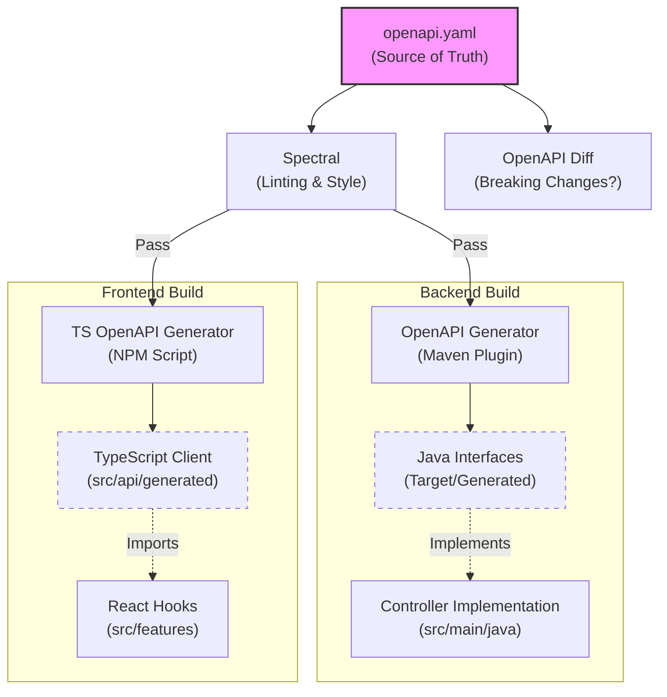

# API Contract

This directory contains the **OpenAPI 3.1.0 Specification**, which serves as the **Single Source of Truth** for our application's interface. We follow a strict **API-First** workflow.

## Table of Contents

- [Prerequisites](#prerequisites)
- [The API-First Workflow](#the-api-first-workflow)
- [API Summary](#api-summary)
- [Directory Structure](#directory-structure)
- [Key Commands](#key-commands)
- [Governance Rules](#governance-rules)
- [Development Cycle](#development-cycle)

## Prerequisites

- **Node.js** 25+
- Run `npm install` from the `api/` directory before using any commands

## The API-First Workflow

Code is a derivative of the specification. We do not generate the spec from code; we generate the code from the spec.



## API Summary

The specification defines endpoints for two domains:

| Tag | Endpoints | Auth |
|-----|-----------|------|
| **Greetings** | `GET /v1/greetings` (list, paginated), `POST /v1/greetings` (create), `GET /v1/greetings/{id}` (get), `PUT /v1/greetings/{id}` (update), `PATCH /v1/greetings/{id}` (patch), `DELETE /v1/greetings/{id}` (delete) | GET is public; write operations require Bearer JWT |
| **User** | `GET /v1/me` (current user info) | Bearer JWT required |

**Security scheme:** `BearerAuth` (HTTP Bearer, JWT format via Keycloak OIDC).

**Error model:** All error responses (4xx/5xx) use RFC 7807 `ProblemDetail` with `application/problem+json`, including `traceId` for log correlation.

## Directory Structure

```
api/
├── specification/
│   └── openapi.yaml          # The contract — edit this to change the API
├── rules/
│   ├── style.yaml            # Naming, versioning, and structure rules
│   └── examples.yaml         # Response example enforcement rules
├── .spectral.yaml            # Spectral config (extends both rulesets)
├── openapitools.json         # Pins openapi-generator-cli to v7.18.0
└── package.json              # Scripts and tooling dependencies
```

## Key Commands

Run these commands from the `api/` directory:

| Command | Description |
|:--------|:------------|
| `npm run lint` | Validates the spec against Spectral governance rules (style + examples). **Run after every edit.** |
| `npm run validate` | Structural validation of the spec via openapi-generator-cli. |
| `npm run diff` | Checks for breaking changes using openapi-diff. Requires two file arguments (e.g., old spec and new spec). |
| `npm run mock` | Starts a Prism mock server on port 4010. Responses are generated from the `examples` blocks in the spec. |

## Governance Rules

The Spectral linter enforces strict governance via two custom rulesets:

### Style Rules (`rules/style.yaml`)

- **Paths** must use `kebab-case` and start with `/v{n}/`
- **OperationIds** must be `camelCase`
- **Schema properties** must be `camelCase`
- Operations must have `summary`, `description`, and `tags`
- All 4xx/5xx responses must reference the `ProblemDetail` schema with `application/problem+json`
- Schema names must use appropriate suffixes (`*Request` for write models, `*Response`/`*Page`/`*Dto` for read models)
- `additionalProperties` must be explicitly set on all object schemas
- Enum values must be `SCREAMING_SNAKE_CASE` or `lowercase`
- Server URLs must be HTTPS or `http://localhost`

### Example Rules (`rules/examples.yaml`)

- All 2xx responses **must** have at least one named `example` (these power the Prism mock server)
- Examples must include both `summary` and `value` fields
- Request bodies should have `examples`
- Error response examples must include `type`, `title`, `status`, `timestamp`, and `traceId`

## Development Cycle

1.  **Modify** `specification/openapi.yaml`.
2.  **Lint** to ensure validity: `npm run lint`.
3.  **Check for breaking changes**: `npm run diff` (if breaking, bump `info.version` major).
4.  **Propagate** to downstream consumers:
    *   **Backend**: Run `cd ../backend && ./mvnw clean compile` to regenerate Java interfaces.
    *   **Frontend**: Run `cd ../frontend && npm run api:generate` to regenerate the TypeScript client.
