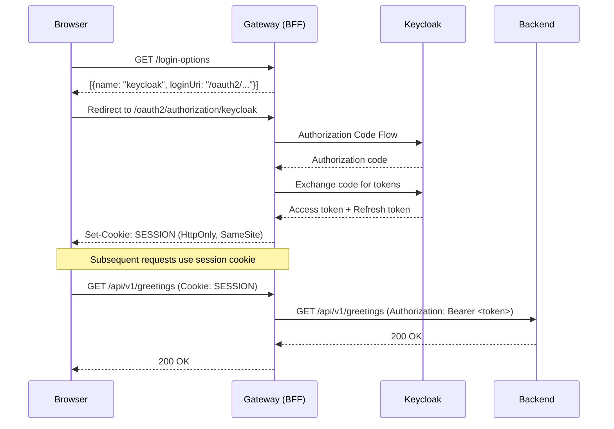

# Gateway (BFF)

Spring Cloud Gateway acting as a **Backend-for-Frontend (BFF)** -- the single public entry point for the frontend SPA. Handles OAuth2 login flows and session management so that tokens are never exposed to the browser.

## Table of Contents

- [Why a BFF?](#why-a-bff)
- [Prerequisites](#prerequisites)
- [Quick Start](#quick-start)
- [How It Works](#how-it-works)
- [Spring Profiles](#spring-profiles)
- [Endpoints](#endpoints)
- [Environment Variables](#environment-variables)
- [Testing](#testing)
- [Docker](#docker)
- [Adding a New OAuth2 Provider](#adding-a-new-oauth2-provider)

## Why a BFF?

In a traditional SPA + OAuth2 setup, the browser stores access tokens (in localStorage or cookies), exposing them to XSS attacks. The BFF pattern eliminates this risk:



The browser only ever sees a session cookie. JWTs stay server-side.

## Prerequisites

- **Java** 25
- **Maven** 3.9+ (or use the included `./mvnw` wrapper)
- **Keycloak** running with the `template-realm` realm configured (available via the root `docker-compose.yml`)

## Quick Start

```bash
# Start with local profile (Keycloak on localhost:9000)
./mvnw spring-boot:run -Dspring-boot.run.profiles=local
```

The gateway starts on `http://localhost:8080` (configurable via `GATEWAY_PORT`).

Requires:
- Keycloak running on `localhost:9000` with the `template-realm` realm
- The `KC_CLIENT_SECRET` environment variable set for the `template-gateway` client

## How It Works

### Token Relay

All requests matching `/api/**` are proxied to the backend. The `TokenRelay` gateway filter reads the access token from the server-side session and injects it as a `Bearer` token in the `Authorization` header:

```yaml
routes:
  - id: backend-api-route
    uri: ${backend-host}:${backend-port}
    predicates:
      - Path=/api/**
    filters:
      - TokenRelay=
```

### Session & Cookie Security

| Setting | Value | Purpose |
|---------|-------|---------|
| `HttpOnly` | `true` | Prevents JavaScript access to session cookie |
| `SameSite` | `Lax` | CSRF mitigation for cross-origin requests |
| `Secure` | `true` in staging/prod | Cookie only sent over HTTPS |
| CSRF | Cookie-accessible token | SPA reads `XSRF-TOKEN` cookie and sends `X-XSRF-TOKEN` header |

### Back-Channel Logout

Keycloak can directly notify the gateway to invalidate sessions when a user logs out from another device or admin revokes a session.

## Spring Profiles

| Profile | Gateway Port | Keycloak | Backend | Secure Cookies |
|---------|-------------|----------|---------|----------------|
| `local` | `${GATEWAY_PORT}` (8080) | `localhost:9000` | `localhost:8081` | `false` |
| `dev` | `${GATEWAY_PORT}` (8080) | `keycloak:8080` (Docker) | `backend:8081` (Docker) | `false` |
| `staging` | `${GATEWAY_PORT}` (8080) | `${KEYCLOAK_HOST}:443` | `${BACKEND_HOST}:8081` | `true` |
| `prod` | `${GATEWAY_PORT}` (8080) | `${KEYCLOAK_HOST}:443` | `${BACKEND_HOST}:8081` | `true` + JSON logging |

## Endpoints

| Path | Method | Auth | Description |
|------|--------|------|-------------|
| `/login-options` | GET | Public | Returns list of configured OAuth2 providers with login URIs |
| `/oauth2/authorization/keycloak` | GET | Public | Initiates OAuth2 Authorization Code Flow |
| `/logout` | POST | Authenticated | Logout (invalidates session + back-channel to Keycloak) |
| `/api/**` | * | Pass-through | Proxied to backend with `TokenRelay` (Bearer token injection) |
| `/actuator/health/liveness` | GET | Public | Kubernetes liveness probe |
| `/actuator/health/readiness` | GET | Public | Kubernetes readiness probe |

## Environment Variables

| Variable | Default | Description |
|----------|---------|-------------|
| `GATEWAY_PORT` | `8080` | Gateway listen port |
| `KC_CLIENT_SECRET` | *(required)* | Keycloak client secret for `template-gateway` |
| `KEYCLOAK_HOST` | varies by profile | Keycloak hostname |
| `KEYCLOAK_PORT` | varies by profile | Keycloak port |
| `BACKEND_HOST` | varies by profile | Backend service hostname |
| `BACKEND_PORT` | `8081` | Backend service port |
| `FRONTEND_HOST` | varies by profile | Frontend origin (for CORS) |
| `FRONTEND_PORT` | varies by profile | Frontend port (for CORS) |
| `COOKIE_SECURE` | `false` | Set to `true` in production (HTTPS only) |

## Testing

```bash
./mvnw test
```

Tests run with `@ActiveProfiles("test")`, which disables real OIDC and permits all requests. The test suite includes:
- Context load smoke test
- `LoginOptionsController` unit test with MockMvc

## Docker

The Dockerfile supports three build stages:

```bash
# Full build from source (production stage)
docker build -t gateway:latest -f gateway/Dockerfile .

# CI stage (requires pre-built JAR in gateway/target/)
docker build --target ci -t gateway:ci -f gateway/Dockerfile .
```

**Note:** The Docker build context must be the **repository root** (not `gateway/`).

The image uses `gcr.io/distroless/java25-debian13` and runs as a non-root user. JVM is tuned with `-XX:MaxRAMPercentage=75` and `-XX:+UseG1GC`.

## Adding a New OAuth2 Provider

To add a new provider (e.g., Google):

1. Add the registration in `application.yaml`:
   ```yaml
   spring.security.oauth2.client:
     provider:
       google:
         issuer-uri: https://accounts.google.com
     registration:
       google:
         client-id: ${GOOGLE_CLIENT_ID}
         client-secret: ${GOOGLE_CLIENT_SECRET}
         scope: openid,profile,email
   ```

2. The new provider automatically appears in the `GET /login-options` response -- no code changes needed.

3. The frontend discovers it dynamically and renders a login button for it.
