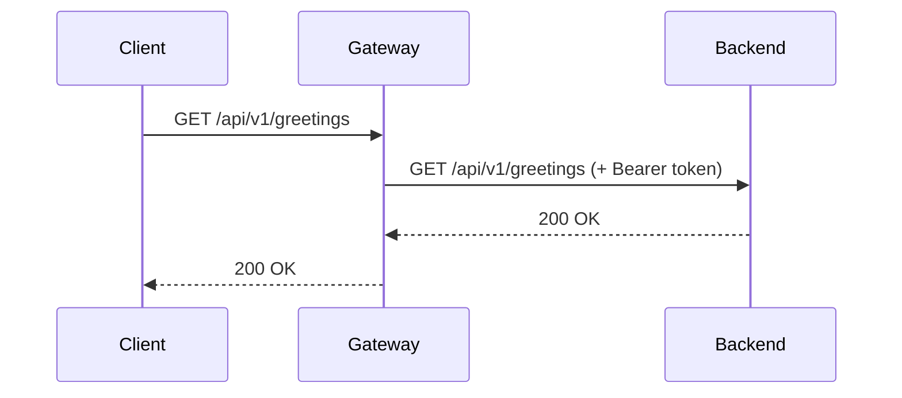

# Documentation Portal

The project's documentation site, built with [Docusaurus 3](https://docusaurus.io/) and enhanced with interactive API reference, Mermaid.js diagrams, and PlantUML support via Kroki.

## Table of Contents

- [Prerequisites](#prerequisites)
- [Quick Start](#quick-start)
- [Documentation Structure](#documentation-structure)
- [Features](#features)
- [Key Commands](#key-commands)
- [Writing Documentation](#writing-documentation)
- [Docker](#docker)

## Prerequisites

- **Node.js** >= 20 (25 recommended to match the project standard)
- The `api/specification/openapi.yaml` file must exist (it is automatically copied to `static/` by pre-build hooks)
- Set `NODE_OPTIONS="--no-experimental-webstorage"` if builds fail with a `SecurityError` related to `localStorage`

## Quick Start

```bash
npm install
npm start
```

Opens the documentation site at `http://localhost:3000`. Changes are reflected live without restarting.

## Documentation Structure

The site follows the [Arc42](https://arc42.org/overview) template for architecture documentation:

```
website/docs/
├── intro.md                        # Landing page / Getting started
├── product/                        # The "Why & What"
│   ├── intro.md                    #   Product vision
│   └── templates/
│       └── prd-template.md         #   PRD template for new features
├── architecture/                   # The "How" (Arc42 sections 01-12)
│   ├── 01-introduction-and-goals/  #   Requirements, quality goals, stakeholders
│   ├── 02-architecture-constraints/
│   ├── 03-context-and-scope/       #   Business & technical context diagrams
│   ├── 04-solution-strategy/       #   Fundamental design decisions
│   ├── 05-building-block-view/     #   System decomposition (whitebox views)
│   ├── 06-runtime-view/            #   Dynamic behavior (sequence diagrams)
│   ├── 07-deployment-view/         #   Infrastructure mapping
│   ├── 08-crosscutting-concepts/   #   API-first governance, testing patterns
│   ├── 09-architecture-decisions/  #   ADRs (Architecture Decision Records)
│   ├── 10-quality-requirements/
│   ├── 11-risks-and-technical-debt/
│   └── 12-glossary/
├── operations/                     # The "How to Run"
│   └── ...                         #   Runbooks, config, deployment procedures
├── developer-guides/               # The "How to Contribute"
│   ├── creating-endpoints.md       #   Step-by-step API-first tutorial
│   ├── dev-cheatsheet.md           #   Common commands reference
│   └── references.md               #   Links and resources
└── agent/                          # AI agent plans and prompts
```

## Features

### Interactive API Reference (Scalar)

An interactive API reference is available at `/api-reference`, powered by [@scalar/docusaurus](https://github.com/scalar/scalar). It renders the OpenAPI spec from `static/openapi.yaml` (automatically copied from `api/specification/openapi.yaml` during `prestart`/`prebuild`).

### Mermaid.js Diagrams

Mermaid diagrams are rendered natively. Use fenced code blocks with the `mermaid` language:

````markdown

````

### Kroki / PlantUML Support

PlantUML and other diagram types are supported via [Kroki](https://kroki.io/). Use fenced code blocks with the `plantuml` language. Diagrams are rendered as inline SVG at build time.

**Note:** This requires network access to `https://kroki.io` during builds.

### Broken Link Detection

The build is configured with `onBrokenLinks: 'throw'` -- any broken internal links will **fail the build**. This ensures documentation integrity.

## Key Commands

| Command | Description |
|:--------|:------------|
| `npm start` | Start local dev server on port 3000 (auto-copies openapi.yaml) |
| `npm run build` | Build static site (auto-copies openapi.yaml, fails on broken links) |
| `npm run serve` | Serve the built static site locally |
| `npm run clear` | Clear Docusaurus cache (useful for troubleshooting) |
| `npm run typecheck` | Validate TypeScript configuration |

## Writing Documentation

### Frontmatter

Every Markdown file must have valid Docusaurus frontmatter:

```yaml
---
id: unique-id
title: Human Readable Title
sidebar_position: 1
---
```

### Rules

- **Mermaid.js** is mandatory for architectural diagrams -- binary images (PNG/JPG) are prohibited for architecture
- **Single Source of Truth** -- do not duplicate information; link to the canonical source
- **ADRs** go in `docs/architecture/09-architecture-decisions/` using the MADR format
- **PRDs** use the template at `docs/product/templates/prd-template.md`

## Docker

The site is containerized for production deployment using a multi-stage build (Node.js builder + nginx):

```bash
# Build from the repository root (not website/)
docker build -f website/Dockerfile -t template-app-docs .
```

The Docker build context must be the **repository root** because the Dockerfile copies `api/specification/openapi.yaml` from a sibling directory.

The nginx server listens on **port 3001**, serves gzip-compressed static assets with 1-year cache headers, and runs as a non-root user.
